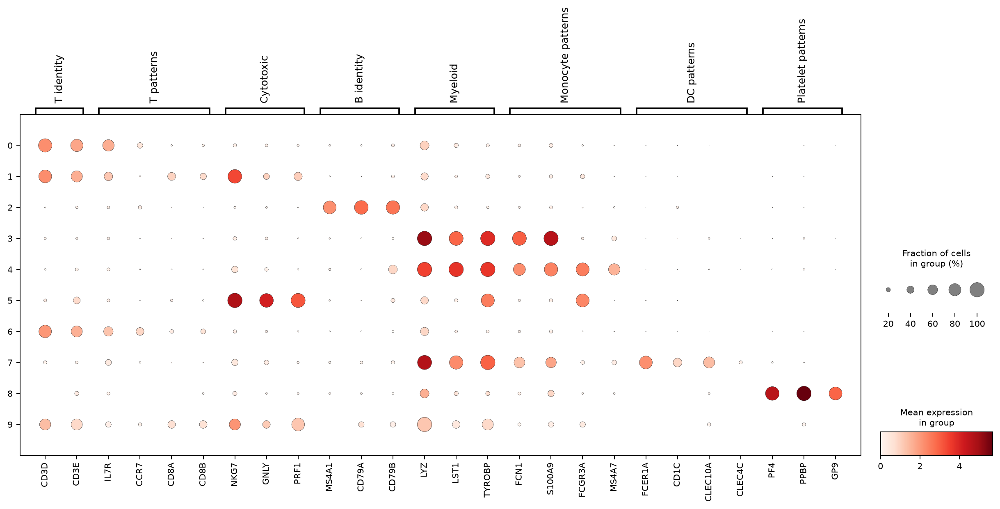

# PBMC3k: QC Sensitivity and Evidence-Based Annotation

A learning and methods evaluation project examining how quality-control
choices and clustering resolution affect single-cell annotation.

## Main question

Do broad cell-identity interpretations remain supported when the
mitochondrial QC threshold changes?

## Dataset and methods

- Human PBMC3k: 2,700 cell-associated barcodes from a single donor.
- Input: unnormalized counts for already-called cells.
- Scrublet screening identified 32 candidate doublets.
- Mitochondrial thresholds compared: 5%, 8% and 10%.
- Normalization to 10,000 counts per cell followed by log1p.
- 2,000 highly variable genes; PCA and neighbor-graph construction.
- Leiden clustering reviewed at resolutions 0.5 and 1.0.
- Provisional annotation using multiple markers.
- Reference comparison with CellTypist Immune_All_Low.
- Preprocessing and clustering recomputed for QC sensitivity.

## Main observations

| QC threshold | Retained cells | ARI versus the 8% baseline |
|---|---:|---:|
| 5% | 2,611 | 0.7568 |
| 8% | 2,660 | Baseline |
| 10% | 2,662 | 0.8791 |

The same candidate doublets were excluded in all variants.

A 15-cell platelet-associated group showed coordinated PF4, PPBP and
GP9 expression. Higher clustering resolution separated this group
from a predominantly monocyte-associated cluster.

All 15 cells remained together under both alternative QC thresholds.
CellTypist predicted Megakaryocytes/platelets for 11 of the 15 cells.

Broad marker patterns were largely preserved, while some T-cell
and monocyte cluster boundaries changed. Seven mixed-marker cells
retained an uncertain annotation.

## Marker evidence

Dot size represents the fraction of cells with detected expression.
Color represents mean log-normalized expression.

## Interpretation limits

- This is an educational reanalysis, not a new biological discovery.
- QC thresholds are context-dependent.
- Low gene counts alone do not establish poor quality.
- Reference predictions are supporting evidence, not experimental validation.
- ARI measures clustering agreement, not annotation accuracy.
- Ambient RNA correction was not performed.
- Single-donor data cannot support population-level condition comparisons.
- UMAP separation alone does not establish function or mechanism.

## Data representation

- `layers["counts"]`: raw counts for retained genes.
- `X`: log1p expression after normalization to 10,000 counts per cell.
- `obsm`: PCA and UMAP coordinates.

QC metrics were calculated before gene filtering.

## Installation and execution

Use an isolated Python 3.12 environment.

Install packages with `python -m pip install -r requirements.txt`.
Run `python scripts/run_workflow.py` from the project root.

The runner executes scripts 00-18 sequentially and saves execution logs.
Internet access is required for initial data and model downloads.
Rerunning writes to the same generated output paths.

A fresh end-to-end run of the packaged workflow has not yet been
verified. Recorded versions describe the environment at packaging
time; the environment was not locked throughout development.

Manual labels in script 16 refer to the reviewed resolution-1.0
clusters. If clustering changes, labels must be reviewed before reuse.

Some supplementary inspection tables were created interactively
and are not regenerated by the numbered workflow.

## Project structure

- `scripts/`: input preparation and analysis.
- `docs/`: interpretation and environment records.
- `results/`: figures and tables.
- `data/`: downloaded inputs and generated objects, excluded from Git.

## Documentation

- [Annotation report](docs/m08_annotation_report.md)
- [QC decisions](docs/qc_decisions.md)
- [Software versions](docs/software_versions.csv)
- [Input fingerprints](docs/input_fingerprints.json)

## Resources

- [Scanpy PBMC3k](https://scanpy.readthedocs.io/en/stable/generated/scanpy.datasets.pbmc3k.html)
- [CellTypist](https://github.com/Teichlab/celltypist)
